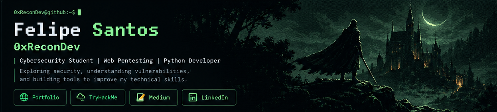

### Cybersecurity Student · Web Pentesting · Python Developer

Exploring offensive security, building networking tools, and documenting hands-on learning.

---

## `> About me`

I'm **Felipe Santos (0xReconDev)**, a cybersecurity student interested in **offensive security, web application security, Linux, and networking**.

I work on Python, C, and Bash projects to deepen my understanding of systems and protocols, and I share what I learn through **CTF write-ups and practical labs**.

## `> Tech stack`

**Programming & scripting**

**Security & tools**

`TCP/IP` · `HTTP/HTTPS` · `SSH` · `SMB` · `Sockets` · `CTFs` · `Web Pentesting`

## `> Featured projects`

| Project | Focus |
|:---|:---|
| **[Network Diagnostics Tool](https://github.com/0xReconDev/network-diagnostics-tool)** | Python · TCP port checks, network diagnostics and HTTP information gathering |
| **[TCP/UDP Server–Client](https://github.com/0xReconDev/TCP-UDP-Server-Client)** | Python · Socket communication and session logging |
| **[PortScan-C](https://github.com/0xReconDev/PortScan-C)** | C · TCP port connectivity checks |
| **[PortScan-Python](https://github.com/0xReconDev/PortScan-Python)** | Python · TCP port connectivity checks |
| **[Directory Enumeration Tool](https://github.com/0xReconDev/directory-enumeration-tool)** | Bash · Web directory enumeration |

**[Explore all repositories](https://github.com/0xReconDev?tab=repositories)**

<table>
<tr>
<td width="50%" valign="top">

### 📝 Write-ups & research

Documenting practical security exercises, enumeration and vulnerability exploitation in authorized labs.

**[Read on Medium](https://medium.com/@devandcyber)**

</td>
<td width="50%" valign="top">

### 🧩 CTFs & labs

Practicing cybersecurity skills through hands-on challenges and technical investigations.

**[TryHackMe profile](https://tryhackme.com/p/0xReconDev)**

</td>
</tr>
</table>

---

### `> ./explore_portfolio.sh`

**[Launch my interactive cybersecurity portfolio](https://0xrecondev.github.io/portfolio/)**

*Learning by doing. Documenting the process.*

